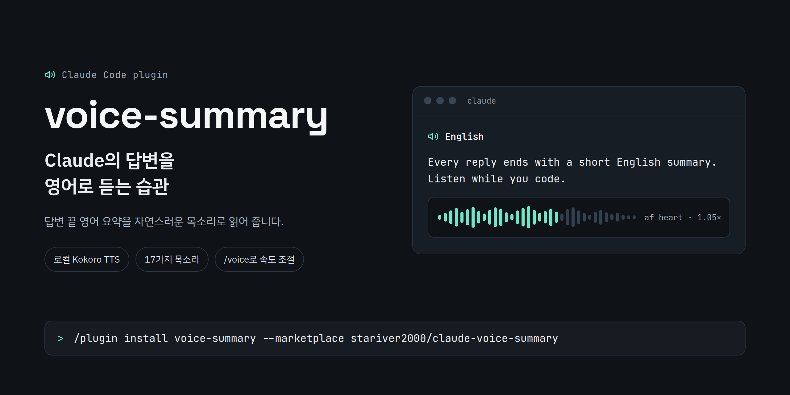

# voice-summary



영어 듣기 연습을 위한 Claude Code 플러그인(mod)입니다. Claude가 답변할 때마다 끝에 `🔊 English`라는 제목으로 쉬운 영어 요약을 2~3문장 붙이고, 이 플러그인이 그 요약을 소리 내어 읽어 줍니다.

음성은 [Kokoro](https://github.com/thewh1teagle/kokoro-onnx)로 만듭니다. 자연스러운 목소리를 내는 작은 로컬 음성 합성(TTS) 모델이라 CPU만으로 돌아가고, 어떤 온라인 서비스에도 데이터를 보내지 않습니다.

## 설치

Claude Code 터미널 세션의 프롬프트에 입력하세요.

```
/plugin install voice-summary --marketplace stariver2000/claude-voice-summary
```

마켓플레이스를 추가할지 물으면 `y`를 누르고, 설치 범위를 고르세요. user 범위를 고르면 모든 세션에서 켜집니다.

셸에서 설치할 때는 이렇게 입력합니다.

```
claude plugin install voice-summary --marketplace stariver2000/claude-voice-summary
```

`/plugin`이 실행되지 않는 Claude 데스크톱 앱에서는 프롬프트 입력창 옆의 + 버튼을 누르고, Plugins → Add marketplace에 `stariver2000/claude-voice-summary`를 입력한 뒤 Add plugin을 누르세요.

## 처음 설정

설치한 뒤 Claude Code에서 한 번만 실행하세요. `~/.local/share/claude-voice`에 Python 가상환경을 만들고 음성 모델(약 350MB)을 내려받습니다.

```
/voice setup
```

필요한 것: Python 3.10 이상, `curl`, 오디오 재생 프로그램(리눅스는 `paplay`, `pw-play`, `aplay`, `ffplay` 중 하나, macOS는 `afplay`). 다른 위치에 설치하려면 `CLAUDE_VOICE_HOME` 환경 변수를 지정하세요.

## 사용법

| 명령 | 하는 일 |
| --- | --- |
| `/voice` | 현재 설정 보기 |
| `/voice on`, `/voice off` | 음성 요약 켜기, 끄기 |
| `/voice voice <이름>` | 목소리를 바꾸고 샘플 듣기 |
| `/voice speed <0.5-2>` | 말하는 속도를 바꾸고 샘플 듣기 (기본값 1.05) |
| `/voice list` | 목소리 목록 보기 |
| `/voice test` | 현재 목소리 들어 보기 |

목소리 이름의 첫 글자는 억양(`a` 미국식, `b` 영국식), 둘째 글자는 성별(`f` 여성, `m` 남성)입니다. 예: `af_heart`(기본값), `af_bella`, `am_michael`, `bf_emma`, `bm_george`.

새 답변이 오면 아직 재생 중인 이전 요약은 멈추고 새 요약을 읽습니다.

## 라이선스

MIT
